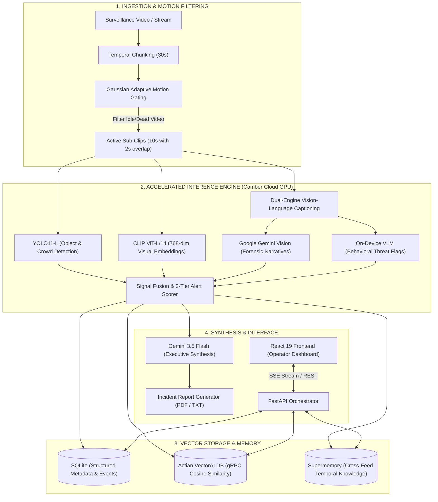

# Vigilant AI — Autonomous Surveillance Intelligence & Semantic Search

> **Transforming passive CCTV cameras into proactive, real-time threat intelligence and natural-language searchable video infrastructure.**

[](https://camber.cloud)
[](https://deepmind.google/gemini)
[](https://actian.com)
[](https://supermemory.ai)
[](https://fastapi.tiangolo.com)
[](https://react.dev)

---

## 📌 Executive Summary & The Problem

Over **1 billion CCTV cameras** are deployed worldwide today, recording millions of hours of surveillance footage every single hour. Yet:
- **99% of surveillance video is never watched live**: Human security operators experience visual fatigue within 20 minutes of monitoring split screens.
- **Dumb Motion Sensors Cause Alarm Fatigue**: Conventional cameras trigger false alerts from headlights, tree shadows, weather, and insects.
- **Forensic Video Scrubbing is Slow and Painful**: When an incident occurs (theft, physical assault, intrusion), operators spend hours manually scrubbing timelines across dozens of camera feeds.
- **CCTV is a Reactive "Dumb Recorder"**: Current video management systems (VMS) act as digital tape recorders that only record crimes rather than proactively flagging threats and extracting queryable knowledge.

**Vigilant AI solves this paradigm.**

Vigilant AI turns raw, unstructured surveillance video streams into **structured, semantically indexed intelligence**. It automatically isolates motion windows, runs high-speed object and anomaly detection, generates forensic descriptions, indexes multi-modal embeddings in **Actian VectorAI DB**, and enables security operators to interrogate hours of footage in plain conversational English through a ChatGPT-style interface with instant sub-second response times.

---

## 🏢 Real-World Use Cases

```
┌─────────────────────────────────────────────────────────────────────────────┐
│                            REAL-WORLD APPLICATIONS                          │
└───────┬─────────────────────────┬─────────────────────────┬─────────────────┘
        │                         │                         │
        ▼                         ▼                         ▼
┌───────────────┐         ┌───────────────┐         ┌───────────────┐
│ Retail & Loss │         │ Public Safety │         │  Industrial & │
│  Prevention   │         │ & Smart City  │         │  Perimeter    │
├───────────────┤         ├───────────────┤         ├───────────────┤
│• Shoplifting  │         │• Assault &    │         │• After-hours  │
│  motion cues  │         │  fight alert  │         │  trespassing  │
│• Loitering at │         │• Abandoned    │         │• Hazard & PPE │
│  checkout     │         │  bag / item   │         │  violations   │
│• Night-time   │         │• Crowd crush  │         │• Vehicle gate │
│  intrusion    │         │  surges       │         │  anomalies    │
└───────────────┘         └───────────────┘         └───────────────┘
```

1. **Retail & Loss Prevention**
   - Automatically detects suspicious behavioral cues (rapid concealment of goods, erratic pacing near high-value displays, after-hours movement).
   - Generates automated evidence clips with exact timestamps for store managers and insurance adjusters.
2. **Public Transit & Smart Cities**
   - Instantly flags physical altercations, aggressive contact, and sudden crowd surges on train platforms or bus terminals.
   - Detects unattended luggage or suspicious stationary objects in high-traffic concourses.
3. **Critical Industrial Facilities & Warehouses**
   - Monitors restricted perimeter boundaries during scheduled non-operational hours (`after_hours` heuristic).
   - Audits dock activity and flags unauthorized personnel without requiring dedicated guards at every monitor.
4. **Law Enforcement & Forensic Investigation**
   - Eliminates 95% of video scrubbing time. Investigators can ask:
     > *"Show me anyone wearing a black hoodie who entered through the back exit between 2:00 AM and 4:00 AM"*
     Vigilant retrieves the exact video clips in milliseconds via multi-modal vector search.

---

## 🏗️ System Architecture

Vigilant AI employs a **multi-tier hierarchical processing pipeline** designed to balance real-time throughput, GPU resource utilization, and deep reasoning accuracy.



### Architectural Highlights

1. **Adaptive Motion Gating (80% Compute Savings)**:
   Surveillance cameras frequently record hours of empty rooms or static corridors. Vigilant’s motion-difference gating isolates only active windows, dropping idle frames before any heavy neural network is invoked.
2. **Compute Flexibility (Camber Cloud GPU / Modal / Local Direct)**:
   Inference is decoupled from the web orchestrator. It runs natively on **Camber Cloud GPU** (with public tunnel forwarding) for on-demand GPU throughput without credit card gating, with full support for Modal serverless or local GPU execution.
3. **High-Dimensional Semantic Storage (Actian VectorAI DB)**:
   Every sub-clip is transformed into a 768-dimensional normalized embedding via OpenAI's CLIP ViT-L/14. Actian VectorAI DB indexes these embeddings with sub-50ms cosine similarity search, allowing free-form natural language querying without relying on fixed metadata tags.
4. **Dual-Model Threat Consensus**:
   Visual captioning runs parallel verification: Google Gemini provides high-fidelity natural language forensic descriptions, while local computer vision models extract deterministic boolean flags (`is_fighting`, `is_stealing`, `contact_score`). An authoritative hierarchy ensures computer vision detections cannot be hallucinatively overridden by text synthesis.
5. **Two-Phase SSE Streaming Chat**:
   Security operators get instant visual feedback. When querying the chat:
   - **Phase 1 (~100-200ms)**: Actian VectorAI returns matching clip cards with timestamps and alert badges.
   - **Phase 2 (streaming)**: Gemini streams the analytical narrative explaining what occurred in those clips.

---

## ⚡ Deployment with Camber Cloud GPU

To avoid credit card restrictions associated with serverless providers like Modal while maintaining dedicated NVIDIA GPU acceleration (e.g., NVIDIA L4 / A100), Vigilant AI is designed to run seamlessly on **Camber Cloud GPU** with secure reverse tunneling (ngrok / Cloudflare Tunnel).

```
┌─────────────────────────────────┐                 ┌─────────────────────────────┐
│       Camber Cloud GPU          │                 │       Operator Client       │
│  ┌───────────────────────────┐  │                 │  ┌───────────────────────┐  │
│  │ FastAPI + GPU Models      │  │                 │  │ React 19 Frontend     │  │
│  │ (YOLO11, CLIP, Gemini)    │  │                 │  │ (Dashboard & Chat)    │  │
│  └─────────────┬─────────────┘  │                 │  └───────────▲───────────┘  │
│                │                │                 │              │              │
│                ▼                │                 │              │              │
│  ┌───────────────────────────┐  │  HTTPS Tunnel   │              │              │
│  │ Cloudflare / ngrok Tunnel ├──┼─────────────────┼──────────────┘              │
│  │ (Public Endpoint)         │  │                 │                             │
│  └───────────────────────────┘  │                 │                             │
└─────────────────────────────────┘                 └─────────────────────────────┘
```

### 1. Launching on Camber Cloud GPU
1. Launch an on-demand GPU instance on [Camber Cloud](https://camber.cloud) (e.g., NVIDIA L4 or A100).
2. Clone this repository and install dependencies:
   ```bash
   git clone https://github.com/princ/Vigilant.git
   cd Vigilant/backend
   pip install -r requirements.txt
   ```
3. Set your environment variables in `backend/.env`:
   ```bash
   GEMINI_API_KEY=your_gemini_api_key_here
   SUPERMEMORY_API_KEY=your_supermemory_key_here # Optional
   ```
4. Start the backend:
   ```bash
   uvicorn api.main:app --host 0.0.0.0 --port 8000
   ```

### 2. Exposing the Backend URL (Tunneling)
Expose the backend port via Cloudflare Tunnel (no account required) or ngrok:
```bash
# Using Cloudflare Tunnel
cloudflared tunnel --url http://localhost:8000
# Output: https://your-unique-subdomain.trycloudflare.com

# OR using ngrok
ngrok http 8000
# Output: https://your-unique-subdomain.ngrok-free.app
```

### 3. Connect the Frontend
In `vigilant-ai/vite.config.ts` (or via environment variable `VITE_BACKEND_URL`):
```bash
cd ../vigilant-ai
export VITE_BACKEND_URL=https://your-unique-subdomain.trycloudflare.com
npm install
npm run dev
```
Open `http://localhost:5173` to access the full live application.

---

## 🔬 Multi-Stage Alert Matrix

Every clip is evaluated across physical motion magnitude, spatial overlap, person-to-person proximity, and temporal duration (`dwell_time`):

| Alert Stage | UI Indicator | Severity | Trigger Criteria | Action Taken |
|---|---|---|---|---|
| **Stage A** | 🟡 Yellow Badge | Suspicious Activity | Alert Score $\ge 0.40$ (Unusual dwell time, solitary presence after hours) | Logged to event index, flagged in timeline |
| **Stage B** | 🟠 Orange Badge | Concerning Behavior | Alert Score $\ge 0.65$ (Rapid item concealment, aggressive posture, restricted zone) | Immediate notification, priority card in dashboard |
| **Stage C** | 🔴 Pulsing Red Alert | Critical Incident | Alert Score $\ge 0.85$ (Physical altercation, weapon signature, intrusion breach) | Header alert beacon, ambient glow, instant incident dossier generation |

---

## 🛠️ Complete Tech Stack

| Domain | Technology | Role & Justification |
|---|---|---|
| **GPU Compute** | **Camber Cloud GPU** (NVIDIA L4 / A100) / Modal | High-throughput GPU execution for parallel deep learning inferences without credit card barriers. |
| **Vector Database** | **Actian VectorAI DB** | High-performance, purpose-built vector store communicating via gRPC. Sub-50ms cosine similarity search across 768-dim embeddings. |
| **Object Detection** | **YOLO11-L** | State-of-the-art real-time object, person, and vehicle detection with sub-15ms inference latency. |
| **Semantic Embedding** | **OpenAI CLIP ViT-L/14** | Multi-modal alignment model mapping video frames and text prompts into a shared 768-dimensional latent space. |
| **Forensic Captioning** | **Gemini 3.5 Flash Vision** | Deep multimodal vision analysis generating detailed behavioral descriptions and timestamps. |
| **Synthesis Reasoning**| **Gemini 3.5 Flash** | Synthesizes hundreds of clip detections into executive summaries, risk levels, and identified perpetrator/victim dynamics. |
| **Temporal Memory** | **Supermemory** | Cross-video persistent memory engine enabling natural language queries across weeks of historical camera data. |
| **API Orchestrator** | **FastAPI (Python 3.11)** | High-performance asynchronous web framework providing Server-Sent Events (SSE) for two-phase streaming responses. |
| **Structured Store** | **SQLite3** | Zero-latency local storage for fast timeline filtering, clip metadata, and event histories. |
| **Frontend UI** | **React 19 + TypeScript** | Responsive security command center with real-time video playback and chat timeline integration. |
| **Styling & Motion** | **Tailwind CSS v4** | Modern design language utilizing hardware-accelerated animations and ambient alert states. |

---

## 📂 Project Organization

```
Vigilant/
├── backend/
│   ├── api/
│   │   └── main.py              # REST API & Server-Sent Events (SSE) engine
│   ├── services/
│   │   ├── vectordb.py          # Actian VectorAI DB gRPC client & collection manager
│   │   ├── clip_search.py       # Hybrid CLIP vector search + keyword fallback
│   │   ├── gemini_synthesis.py  # Executive risk synthesis & threat validation
│   │   ├── incident_report.py   # Automated PDF/TXT legal incident report exporter
│   │   ├── ingest.py            # Event aggregation & embedding pipeline
│   │   └── db.py                # Relational schema for videos, alerts, and chat
│   ├── workers/
│   │   ├── pipeline.py          # Adaptive motion gating, temporal chunking & alerts
│   │   └── inference.py         # Multi-model GPU inference pipeline (YOLO, CLIP, VLM)
│   ├── uploads/                 # Temporary streaming buffer for raw video files
│   └── requirements.txt         # Python dependencies
│
├── vigilant-ai/                 # React 19 Client
│   ├── src/
│   │   ├── pages/
│   │   │   ├── HomePage.tsx     # Surveillance feed grid & global cross-camera search
│   │   │   ├── VideoPage.tsx    # Live investigation terminal, timeline & video player
│   │   │   └── BenchmarkPage.tsx# GPU compute & Actian VectorAI latency telemetry
│   │   ├── api.ts               # Type-safe API client and SSE stream parser
│   │   └── index.css            # Custom theme definitions & pulsing alert animations
│   ├── vite.config.ts           # Proxy configuration & tunnel endpoints
│   └── package.json
│
└── actian-vectorAI-db-beta/     # Actian VectorAI Docker service & gRPC client wheel
```

---

## 🚀 Quickstart Guide

### Prerequisites
- Python 3.10+
- Node.js 18+
- Docker (for local Actian VectorAI instance)
- Google Gemini API Key ([Google AI Studio](https://aistudio.google.com))

### 1. Start Actian VectorAI DB (Docker)
```bash
cd actian-vectorAI-db-beta
docker compose up -d
# VectorAI service starts on localhost:50051 (gRPC)
```

### 2. Configure & Launch Backend
```bash
cd ../backend

# Create virtual environment
python -m venv .venv
source .venv/Scripts/activate # Windows: .venv\Scripts\activate

# Install dependencies & Actian client
pip install -r requirements.txt
pip install ../actian-vectorAI-db-beta/actiancortex-0.1.0b1-py3-none-any.whl

# Configure Environment
echo "GEMINI_API_KEY=your_key_here" > .env

# Run FastAPI Server
uvicorn api.main:app --reload --port 8000
```

### 3. Launch Frontend
```bash
cd ../vigilant-ai
npm install
npm run dev
# Open http://localhost:5173
```

---

## 🌐 API Reference

| Method | Route | Description |
|---|---|---|
| `POST` | `/api/upload` | Upload surveillance video (up to 5GB) and begin automated pipeline |
| `GET` | `/api/upload/status/{id}` | Real-time progress and job state polling |
| `GET` | `/api/videos` | Retrieve all processed video surveillance sessions |
| `GET` | `/api/videos/{id}/events` | Fetch all indexed sub-clip events with bounding detections |
| `GET` | `/api/videos/{id}/alerts` | Filtered list of Stage A, B, and C threat incidents |
| `GET` | `/api/videos/{id}/summary` | AI-generated executive narrative, behavioral intent, and key moments |
| `GET` | `/api/videos/{id}/report` | Download formal incident report (`format=pdf` or `format=txt`) |
| `GET` | `/api/chat/stream` | Server-Sent Events (SSE) semantic video search stream |
| `POST` | `/api/memory/query` | Cross-video intelligence query over Supermemory |
| `GET` | `/api/benchmarks/vectorai` | Live Actian VectorAI query latency and vector density stats |

---

## 🔮 Enterprise Roadmap & CCTV Scalability

To transition Vigilant AI from a single-feed system to an **enterprise-wide Smart City / Multi-Facility Video Management System (VMS)**, the following architectural scaling path is established:

1. **RTSP / ONVIF Live Stream Ingestion**
   - Replace file uploads with live camera streams via RTSP/WebRTC ingested through GStreamer / FFmpeg pipelines into distributed frame ring buffers.
2. **Edge-to-Cloud Fog Computing**
   - Deploy lightweight edge inferencing (NVIDIA Jetson Orin / on-camera NPUs) running motion gating and quantized YOLO11 (INT8 via TensorRT).
   - Only suspicious candidate frames are transmitted upstream to the Camber GPU cluster, reducing bandwidth consumption by over 90%.
3. **Cross-Camera Multi-Target Tracking & Re-Identification (Re-ID)**
   - Extract appearance feature vectors to track individuals or vehicles across non-overlapping camera fields of view (e.g., following a suspect from Parking Lot → West Entrance → Elevator Lobby).
4. **Automated Incident Dispatch Webhooks**
   - Configure instant Stage C dispatch webhooks into enterprise incident management platforms (Slack, PagerDuty, Genetec Security Center, Milestone XProtect, or 911 dispatch CAD systems).
5. **Horizontal Worker Auto-Scaling**
   - Decouple video decoding and inference using an event bus (Apache Kafka / Redis Streams) and auto-scale Camber GPU worker nodes based on stream backlog using Kubernetes (KEDA).

---

## 📄 License
This project is licensed under the MIT License.
