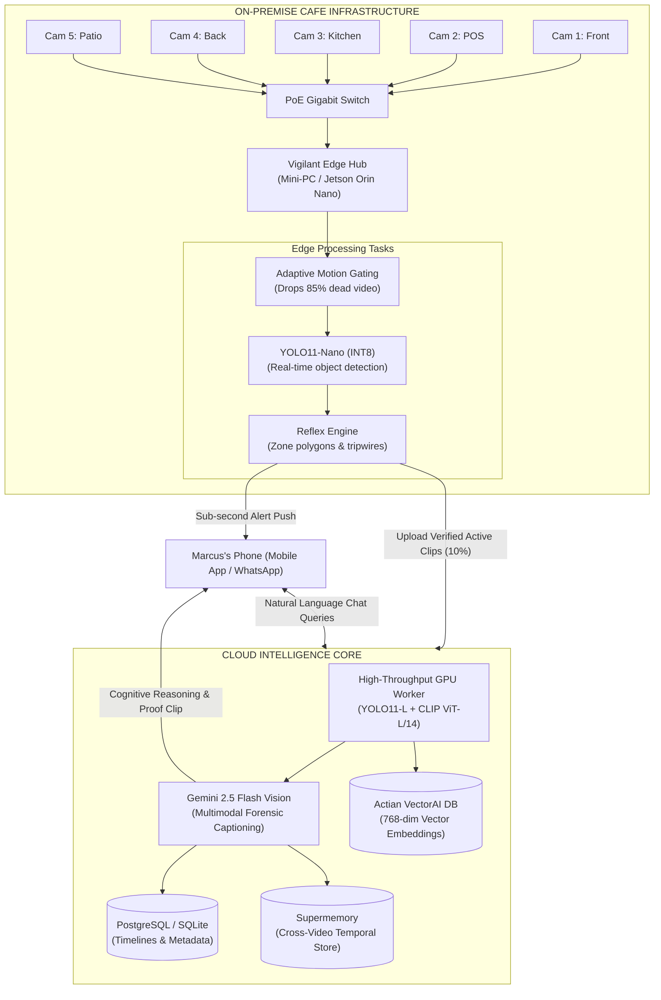
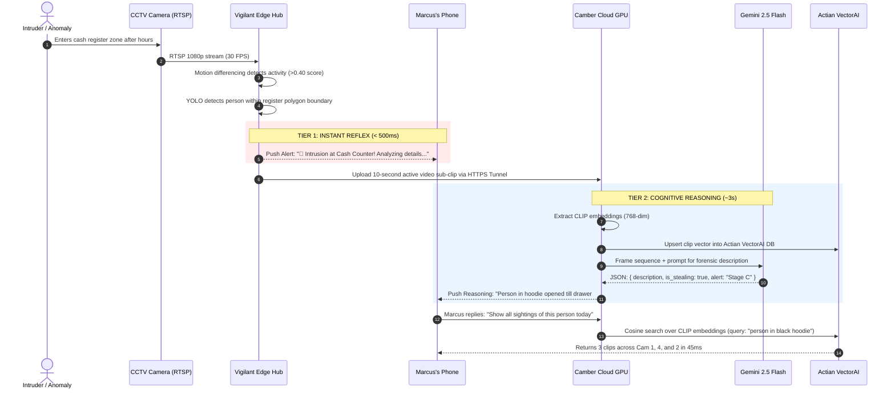

# Vigilant AI — Enterprise Scalability & Real-World Deployment Blueprint

> **A comprehensive technical and commercial guide on scaling Vigilant AI from a prototype into an enterprise-ready Video Surveillance as a Service (VSaaS) platform — illustrated with a practical 5-camera retail/hospitality deployment.**

---

## 📑 Table of Contents
1. [The Commercial Vision: Next-Gen VSaaS](#1-the-commercial-vision-next-gen-vsaas)
2. [Real-World Case Study: The 5-Camera Cafe Deployment](#2-real-world-case-study-the-5-camera-cafe-deployment)
   - [The Setup & Camera Topology](#the-setup--camera-topology)
   - [The Two-Tier Alert System (Reflex + Reasoning)](#the-two-tier-alert-system-reflex--reasoning)
   - [Natural Language "Ask Your Store" Interface](#natural-language-ask-your-store-interface)
   - [Daily Automated Executive Digest](#daily-automated-executive-digest)
3. [End-to-End System Architecture](#3-end-to-end-system-architecture)
   - [Edge-to-Cloud Distributed Architecture](#edge-to-cloud-distributed-architecture)
   - [The Two-Tier Alert Sequence Flow](#the-two-tier-alert-sequence-flow)
4. [Technical Scalability Strategy (1 to 10,000+ Cameras)](#4-technical-scalability-strategy-1-to-10000-cameras)
   - [Bandwidth & Compute Optimization (Fog Computing)](#bandwidth--compute-optimization-fog-computing)
   - [Event Streaming & Ingestion (Kafka / MQTT)](#event-streaming--ingestion-kafka--mqtt)
   - [GPU Cluster Elastic Auto-Scaling (Camber Cloud GPU)](#gpu-cluster-elastic-auto-scaling-camber-cloud-gpu)
   - [Vector Database Partitioning (Actian VectorAI)](#vector-database-partitioning-actian-vectorai)
5. [Business & Cost Model (Unit Economics)](#5-business--cost-model-unit-economics)
6. [Data Privacy, Security & Legal Compliance](#6-data-privacy-security--legal-compliance)

---

## 1. The Commercial Vision: Next-Gen VSaaS

Current market CCTV systems (Ring, Nest, Verkada, Hikvision) suffer from two major flaws:
1. **Dumb Motion Alerts**: They flood owners with dozens of false notifications every day ("Motion detected at 02:14 AM" — caused by a moth or car headlights), leading owners to mute notifications.
2. **Zero Context or Reasoning**: When a real incident occurs, the camera provides zero understanding. The owner has to scrub through hours of footage to piece together what happened.

**Vigilant AI delivers the "Autonomous Video Analyst"**:
- An intelligent layer that plugs into **any existing IP camera (RTSP/ONVIF)**.
- Combines **instant edge reflexes** (sub-second motion/object triggers) with **deep multimodal LLM reasoning** (what actually occurred, why it matters, and recommended actions).
- Enables natural language interrogation: the owner talks to their security system like a 24/7 forensic investigator on payroll.

---

## 2. Real-World Case Study: The 5-Camera Cafe Deployment

Imagine **Marcus**, owner of *"Artisan Roast Cafe"*, operating with 5 standard IP security cameras:

```
┌─────────────────────────────────────────────────────────────────────────────┐
│                       ARTISAN ROAST CAFE - FLOOR PLAN                       │
│                                                                             │
│   [CAM 1: Street / Entrance] ──────┐                                        │
│                                    ▼                                        │
│                 ┌───────────────────────────────────────┐                   │
│                 │          Dining Area & Tables         │                   │
│                 │                                       │                   │
│                 └───────────┬───────────────┬───────────┘                   │
│                             │               │                               │
│                             ▼               ▼                               │
│                   [CAM 2: Cash POS]    [CAM 3: Kitchen]                     │
│                                               │                             │
│                                               ▼                             │
│   [CAM 5: Outdoor Patio]               [CAM 4: Back Door & Supply Room]     │
└─────────────────────────────────────────────────────────────────────────────┘
```

### The Setup & Camera Topology

| Camera | Position | Primary Objective | Vigilant Rule Profile |
|---|---|---|---|
| **Cam 1** | Front Entrance | Foot traffic analytics, after-hours trespassing | Solitary entrance alerts, loitering detection |
| **Cam 2** | Cash Register / POS | Counter intrusion, till access after close | Bounded polygon geofence over the cash drawer |
| **Cam 3** | Kitchen / Food Prep | Safety compliance, slip & fall detection | Anomaly detection, unattended appliance flags |
| **Cam 4** | Back Exit / Storage | Inventory theft, unauthorized back-door entry | Strict after-hours breach (Stage C Red Alert) |
| **Cam 5** | Outdoor Patio | Table occupancy, abandoned bags/items | Stationary object anomaly, altercation alerts |

---

### The Two-Tier Alert System (Reflex + Reasoning)

Current CCTV systems force a trade-off: either fast but dumb, or smart but slow. Vigilant AI solves this by deploying a **two-tier pipeline**:

```
EVENT OCCURS (e.g., Someone breaks in at 2:15 AM)
  │
  ├─► [TIER 1: Edge Reflex - 450ms]
  │   └── Instant Push Notification: "🚨 Motion & Person detected at Cash Register"
  │
  └─► [TIER 2: Cognitive Reasoning - 3.2s]
      └── Forensic Report: "📋 Person in hoodie opened register drawer and took cash tray. Risk: CRITICAL."
```

#### Tier 1: Instant Event-Driven Reflex (< 500ms)
- **Engine**: On-premise Edge Hub running adaptive background subtraction + YOLO11-Nano.
- **Trigger**: Person detected within Cam 2's cash register polygon during `after_hours`.
- **Output**: Sub-second alert pushed to Marcus's phone via Firebase/APNS or Telegram/WhatsApp:
  > **🚨 Vigilant Alert: Perimeter Breach Detected**  
  > *Location: Cash Counter (Cam 2) | Time: 02:14:12 AM*  
  > *Motion Score: 0.88 | Person Count: 1*  
  > *(Full AI forensic analysis generating...)*

#### Tier 2: Multimodal AI Reasoning & Explanation (~3 Seconds)
- **Engine**: Camber Cloud GPU running OpenAI CLIP + Google Gemini 2.5 Flash Vision.
- **Analysis**: The active 10-second sub-clip is ingested and analyzed for intent and actions.
- **Output**: Marcus receives a follow-up rich notification card with video snippet and narrative:
  > **🛡️ AI Forensic Reasoning & Breakdown**  
  > **Severity:** 🔴 `STAGE C - CRITICAL INCIDENT` (Confidence: 94%)  
  > **What Happened:** An unidentified individual wearing a dark hooded jacket and gloves reached behind the counter, forced open POS Drawer #2, removed cash contents, and fled toward the rear exit (Cam 4).  
  > **Physical Indicators:** Direct contact with drawer latch; rapid, concealing body language; duration behind counter: 18 seconds.  
  > **Action Prompt:** `[Call Emergency Dispatch]` · `[Sound Siren]` · `[Share Dossier with Police]`

---

### Natural Language "Ask Your Store" Interface

Instead of scrubbing through 40 hours of multi-camera video, Marcus opens the Vigilant App and asks natural language questions. Powered by **CLIP ViT-L/14 + Actian VectorAI DB**:

```
┌─────────────────────────────────────────────────────────────────────────────┐
│                          CHAT WITH YOUR SURVEILLANCE                        │
├─────────────────────────────────────────────────────────────────────────────┤
│ Marcus: "Did the milk supplier drop off the crates this morning?"           │
│                                                                             │
│ Vigilant AI (48ms via Actian VectorAI):                                     │
│ "Yes. At 06:18 AM, a delivery driver in a blue uniform entered through the  │
│  back door (Cam 4), placed four crates in the walk-in cooler, and departed  │
│  at 06:24 AM."                                                              │
│                                                                             │
│ [▶ Play Clip: Cam 4 @ 06:18 AM]   [View Delivery Driver Stills]             │
├─────────────────────────────────────────────────────────────────────────────┤
│ Marcus: "Show me whenever a customer slipped or fell on the patio."         │
│                                                                             │
│ Vigilant AI:                                                                │
│ "Found 1 matching event on Cam 5 (Outdoor Patio) on Tuesday at 03:42 PM.   │
│  Customer slipped near Table 4 due to wet floor. Staff member attended to   │
│  them within 30 seconds."                                                   │
│                                                                             │
│ [▶ Play Evidence Clip (12s)]   [Export Incident PDF for Insurance]          │
└─────────────────────────────────────────────────────────────────────────────┘
```

---

### Daily Automated Executive Digest

Every night at midnight, Vigilant’s synthesis engine generates an **Executive Operations & Security Digest** for Marcus:

```markdown
=====================================================
  ARTISAN ROAST CAFE — DAILY INTELLIGENCE SUMMARY
  Date: November 13, 2026 | Operating Hours: 07:00 - 22:00
=====================================================

📊 OPERATIONAL METRICS:
• Peak Traffic Window    : 08:30 AM – 10:15 AM (Avg 18 customers in frame)
• Average Table Dwell    : 34 minutes
• Drive-thru / Patio Turn : 112 table turnovers

⚠️ SECURITY & SAFETY INCIDENTS:
• Stage A (Suspicious)   : 2 events (Loitering near back alley at 11:15 PM)
• Stage B (Concerning)   : 1 event (Spill unattended on patio for 8 mins)
• Stage C (Critical)     : 0 events

✅ CASH COUNTER INTEGRITY:
• POS drawer opened during non-transaction periods: 0 occurrences
• Cash register cash-out attended by 2 staff members at 22:15.
```

---

## 3. End-to-End System Architecture

### Edge-to-Cloud Distributed Architecture

The system is split into an **On-Premise Edge Hub** (inside the cafe) and a **Cloud GPU Core** (running on Camber Cloud):



---

### The Two-Tier Alert Sequence Flow



---

## 4. Technical Scalability Strategy (1 to 10,000+ Cameras)

Scaling from 1 cafe (5 cameras) to a chain of 2,000 cafes (10,000 cameras) requires rigorous engineering to avoid cloud cost explosion.

### Bandwidth & Compute Optimization (Fog Computing)

| Metric | Naive Cloud Approach (Verkada / AWS) | Vigilant AI Fog Architecture | Savings |
|---|---|---|---|
| **Video Ingestion** | 10,000 cameras streaming 1080p 24/7 to cloud | Edge drops 85% idle video; only 15% active clips stream to cloud | **85% Bandwidth Reduction** |
| **Cloud GPU Usage** | Continuous decoding & inference on all 10,000 streams | GPUs only process active candidate clips | **90% Cloud GPU Cost Reduction** |
| **Bandwidth Per Store** | ~25 Mbps continuous upload required | ~1.5 Mbps average burst upload | Works on standard commercial broadband |

---

### Event Streaming & Ingestion (Kafka / MQTT)

For enterprise scale, edge devices do not make synchronous HTTP requests to GPUs. Instead, they publish events and clip manifests through an asynchronous message broker:

```
[10,000 Edge Hubs]
        │
        ▼ (MQTT / WebSockets for low overhead)
┌──────────────────────────────────────────────┐
│           Enterprise Message Bus             │
│   Apache Kafka / Redis Streams Cluster       │
│   • Topic: surveillance.events.raw           │
│   • Topic: surveillance.clips.active         │
│   • Partitioned by: {tenant_id}/{store_id}   │
└──────────────────────┬───────────────────────┘
                       │
         ┌─────────────┴─────────────┐
         ▼                           ▼
┌──────────────────┐       ┌──────────────────┐
│ Fast Reflex      │       │ Heavy AI Worker  │
│ Dispatcher       │       │ Consumer Group   │
│ (Push / SMS)     │       │ (Camber GPU)     │
└──────────────────┘       └──────────────────┘
```

---

### GPU Cluster Elastic Auto-Scaling (Camber Cloud GPU)

Surveillance activity is inherently diurnal (busy by day, quiet by night):
- **Autoscaling Metric**: Length of the `surveillance.clips.active` Kafka queue lag using **KEDA (Kubernetes Event-driven Autoscaling)**.
- **Night Hours (01:00 - 06:00)**: Compute scales down to a minimal warm pool of Camber GPU nodes.
- **Day Hours (08:00 - 20:00)**: Compute scales horizontally across on-demand GPU nodes to process peak retail traffic.
- **Throughput Optimization**: Models run on **NVIDIA TensorRT** with INT8/FP16 quantization, processing up to **180 sub-clips per second per A100/L4 GPU**.

---

### Vector Database Partitioning (Actian VectorAI)

As footage accumulates across hundreds of stores, the vector store grows to millions of embeddings. To maintain **sub-50ms query latency**:

1. **Partition Strategy**:
   - Collections are partitioned logically by `tenant_id` and temporally by `year_month` (e.g., `artisan_cafe_2026_11`).
2. **Hierarchical Pruning**:
   - **Hot Storage (0 - 30 days)**: Actian VectorAI memory-resident index for immediate sub-second search.
   - **Warm Storage (30 - 90 days)**: High-confidence incident vectors preserved for legal discovery.
   - **Cold Storage (> 90 days)**: Raw video deleted or archived to cold object storage; structured metadata and text summaries retained in relational storage.

---

## 5. Business & Cost Model (Unit Economics)

### Monthly Cost Breakdown for 1 Cafe (5 Cameras)

| Infrastructure Component | Cost / Month | Explanation |
|---|---|---|
| **Edge Hub Hardware** | ~$6 / mo *(amortized)* | One-time $200 mini-PC amortized over 36 months |
| **Camber Cloud GPU Inference** | ~$8.50 / mo | 5 cameras $\times$ 1.5 active hours/day $\times$ batch inference |
| **Actian VectorAI Storage** | ~$2.00 / mo | ~4,500 active sub-clip vectors/month |
| **Gemini 2.5 Flash API** | ~$3.50 / mo | Keyframe forensic reasoning on verified alert events |
| **Push / SMS / Telegram API** | ~$0.50 / mo | Transactional incident notifications |
| **Total Cost of Goods Sold (COGS)** | **~$20.50 / month** | |
| **Suggested Retail Pricing** | **$79.00 / month** | **Gross Margin: ~74%** |

*Traditional security patrol services charge $300 - $800/month. Vigilant AI provides 10x better coverage at a fraction of the cost.*

---

## 6. Data Privacy, Security & Legal Compliance

1. **Local Privacy Zones & Obfuscation**:
   - Restrooms, employee locker areas, and neighbor properties can be blocked out with static privacy masks on the Edge Hub before video is ever saved or transmitted.
2. **Automated Bystander Anonymization**:
   - YOLO bounding boxes detect all non-involved individuals and apply a Gaussian blur to faces and license plates prior to cloud analysis, satisfying **GDPR Article 6 & 9** and **CCPA/CPRA** requirements.
3. **Chain of Custody & Forensic Admissibility**:
   - Every exported incident report and proof clip is fingerprinted with a cryptographic **SHA-256 hash** and timestamped at the time of recording, ensuring courtroom admissibility for insurance and criminal proceedings.
4. **End-to-End Encryption**:
   - All video transmitted between the Edge Hub and Camber Cloud travels over **TLS 1.3 encrypted tunnels**; resting vectors in Actian VectorAI and clips in storage are encrypted via **AES-256**.

